# iOS-Port — Haskell MathCore nativ als arm64-Statik-Lib

> Ziel: das Spiel auf einem aktuellen Apple-Gerät mit Bluetooth-Controller fliegbar
> machen — **ohne** den Haskell-MathCore neu zu schreiben. Der MathCore wird mit
> **demselben Haskell-Code** per Cross-Compiler zu nativem `arm64-apple-ios`-Code
> kompiliert und als statische Lib in die App gelinkt.
>
> **Status: GELÖST.** Der frühere WASM-Umweg ist überholt — ein nativer GHC-Cross-Compiler
> für iOS existiert wieder.

## Warum nativ (und nicht mehr WASM)

- **iOS verbietet dlopen fremder dylibs** → der MathCore muss statisch in die App.
- **iOS verbietet JIT (W^X)** → ein Interpreter (wasm3) war früher der Ausweg, weil es
  keinen fertigen `arm64-apple-ios`-GHC gab.
- **Das hat sich geändert:** Novavero-AI hat `ghc-ios` wiederbelebt — einen reproduzierbaren
  **GHC 9.14.1 Cross-Compiler für `aarch64-apple-ios`** (BSD-3-Clause, prebuilt Tarball).
  Damit wird aus dem MathCore **nativer** Code: schneller als wasm3, kein Adapter-Marshalling,
  kein zweites Runtime-System. Dieselbe Quelle, dieselbe ABI, **eine** Statik-Lib.

## Architektur

```mermaid
graph LR
    A[Haskell MathCore<br/>17 Module] -->|ghc-ios 9.14.1<br/>-staticlib| B[libborn2flap_math-ios.a<br/>34.8 MB, RTS+base gebündelt]
    B -->|statische b2f_math_* Symbole| C[Born2FlapMathBridge.cpp<br/>direkter Bind]
    C --> D[Born2FlapFlightPawn]
    style B fill:#2a3a2a,stroke:#4c8f4c
```



Der ABI-Vertrag ist unverändert (`Native/include/born2flap_math.h`). Nur die *Rückseite*
von `Born2FlapMathBridge.cpp` wechselt von `FPlatformProcess::GetDllHandle` zu direkter
Symbolbindung (`StepFirmwareVehicle = &b2f_math_step_firmware_vehicle;`).

## Was bereits funktioniert (bewiesen)

1. **Cross-Compile** → `MathCore/dist-newstyle/libborn2flap_math-ios.a`
   (34,8 MB, **28 C-ABI-Symbole**: 14 `b2f_math_*` Wrapper + 14 `hs_b2f_math_*` Exports).
2. **Link-Test** → ein minimales `main()` linkt zu einem echten iOS-Binary
   (`LC_BUILD_VERSION platform=IOS, minos=15.0, sdk=26.2`) mit **nur** `-liconv`:
   ```bash
   xcrun --sdk iphoneos clang -target arm64-apple-ios15.0 -isysroot "$(xcrun --sdk iphoneos --show-sdk-path)" \
     -I Native/include ios_link_test.c MathCore/dist-newstyle/libborn2flap_math-ios.a -liconv
   ```
3. **Keine RTS-Overrides nötig** — der ghc-ios-RTS trägt bereits iOS-korrekte
   `mprotectForLinker` (No-op unter W^X) und `osReserveHeapMemory`. Die früher
   gefürchteten drei Linkzeit-Overrides entfallen komplett.

## Einmalige Voraussetzung

```bash
mkdir -p ~/ghc-ios
curl -L <release-url> | tar xz -C ~/ghc-ios --strip-components=1
#   https://github.com/Novavero-AI/ghc-ios/releases  (242 MB prebuilt)
```

Danach reicht `Tools/build-math-ios.sh` (braucht nur Xcode + iOS SDK).

## Integrationspunkte (bereits umgesetzt)

1. **`Born2Flap.Build.cs`** — iOS-Zweig linkt
   `MathCore/dist-newstyle/libborn2flap_math-ios.a` + `PublicSystemLibraries.Add("iconv")`.
   Android behält den WASM-Weg (kein nativer Android-GHC).
2. **`Born2FlapMathBridge.cpp`** — `#if PLATFORM_IOS || PLATFORM_ANDROID` bindet die
   `b2f_math_*`-Symbole direkt (identisch für nativ-iOS und wasm-Android, nur die
   gelinkte Lib unterscheidet sich).

## Noch offen für den echten Geräte-Build

1. **Unreal iOS-Toolchain** — die Engine liegt auf der externen Platte
   (`/Volumes/Ouranos/Games/UE_5.8`); sobald sie gemountet ist, läuft
   `Build.sh Born2Flap IOS Development` bzw. das Cook+Package über `RunUAT`.
2. **Signing** — ein Apple-Development-Team + Provisioning-Profile für das Gerät
   (Xcode-GUI oder `security`/`codesign`).
3. **Runtime-Smoke auf dem Gerät** — die Statik-Lib linkt sauber; der Beweis, dass
   `b2f_math_runtime_init()` auf echter iOS-Hardware durchläuft, steht noch aus
   (braucht das Gerät, da kein Simulator-Runtime installiert ist und die Lib
   Device-only ist).

## Android (später)

Android hat keinen nativen GHC-Cross-Compiler; dort bleibt der WASM-Weg
(`wasm32-wasi-ghc` + wasm3-Interpreter, `Native/src/born2flap_math_wasm.cpp`).
Dieselbe `.wasm` trägt beide Architekturen. Siehe `docs/mobile-math-backend.md`.
