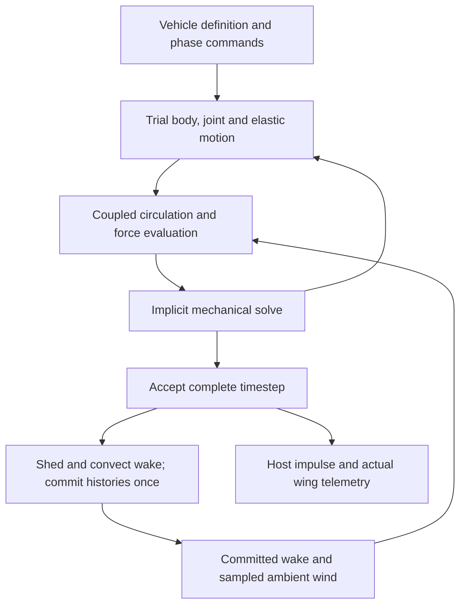

# Tandem-wing aerodynamics and independent phase control

Status: proposed future development; no runtime implementation in this change.  
Date: 2026-11-01.  
Initial target: one controllable, four-wing procedural aircraft on Windows.

## 1. Purpose and success criteria

Extend the flight model to support fore and hind wing pairs whose independently
controlled strokes interact through a shared, evolving airflow. A rear wing must
encounter air affected by earlier strokes, at its actual location and time. The
resulting lift, thrust, moments and power must follow from geometry, motion and
flow; the solver must not assign a performance bonus to a selected phase angle.

The first deliverable is a physics test rig with procedural wings. A finished
dragonfly mesh is not required. A dragonfly-inspired game vehicle follows only
after the rig establishes useful accuracy, stable dynamics and acceptable cost.

Success requires all of the following:

- Four individually identified wings with their own mounting transform, actuator,
  mass, structural properties and phase command.
- Phase-dependent wing interaction reproduced against reference cases, including
  cases where interaction reduces performance.
- Equal resistance laws in glide and flap, local wind sampling, and physical body
  reactions without direct attitude targets in the aerodynamic model.
- Preserved Kestrel regressions: loaded slow roll measures body, tail and actual
  world-space wing motion together; no suspension at zero flow, runaway spin or
  unexplained yaw command.
- Bounded runtime and memory, reproducible measurements, and rendered flight
  verification in addition to solver tests.

This project does not promise complete Navier–Stokes physics, biological accuracy
at every scale, wing contact aerodynamics, or simultaneous deployment on every
platform. Initial interaction is within one vehicle; wakes between separate birds
are a later extension.

## 2. Current implementation and gap

The [2026-11-01 flight audit](flight-physics-2026-11-01.md) records the current
tested behavior. Runtime ownership follows
[ADR 0001](decisions/0001-language-and-runtime-architecture.md): Haskell owns the
physics, the C ABI carries complete vehicle operations, and Unreal/Chaos owns
engine integration, collision and rendering. Earlier broad architecture documents
contain historical proposals; current source and the dated audit are the baseline.

| Area | Current runtime | Required extension |
| --- | --- | --- |
| Vehicle definition | One wing shape, a left/right pair and reference body/tail assumptions | Explicit vehicle components and a collection of wing instances |
| Actuation | Two servos, shared oscillator, differential mixing | Per-wing motion state and phase offsets; explicit control allocation |
| Local forces | Deformed strips, local wind, body/hinge/elastic velocities, lift and drag | Reuse geometry and kinematics; add globally coupled induced flow |
| Unsteady effects | Approximate separation, rotational lift and LEV history | A documented unsteady force formulation and validated separation treatment |
| Pressure memory | Relaxing differential memory between matching left/right strips | Spatial wake that convects independently of the aircraft |
| Dynamics | Coupled roll, hinges and bend/twist, with partial added-air coupling | Generalized six-axis body/wing coupling |
| Host/API | ABI 16, fixed left/right arrays of 16 stations | Versioned variable-wing API and absolute flow-frame pose |
| Visualization | Two wing surfaces and strip diagnostics | Procedural wing instances, phase and wake diagnostics |

The current pressure memory is a calibrated reduced model. It is not a collection
of shed vortices, does not resolve front-to-rear wake travel, and does not provide
explicit wing-induced flow on the tail. Duplicating it for a second pair would not
establish tandem-wing aerodynamics.

## 3. Physical basis and model choice

Fore/hind interaction depends on spacing, stroke geometry, phase and the flow
regime. Published tandem-wing simulations find different vortex interactions
that enhance different wings at different times. This supports measuring the
whole phase-response curve rather than choosing a universal best phase.
[Xie and Huang, 2015](https://pubs-en.cstam.org.cn/article/doi/10.1016/j.taml.2015.01.007)

Force alone is insufficient: robotic-wing experiments demonstrate that phasing
can change aerodynamic efficiency through wake interaction. Their geometry,
Reynolds number and phase convention must be reproduced before using their
results as a quantitative benchmark.
[Usherwood and Lehmann, 2008](https://pmc.ncbi.nlm.nih.gov/articles/PMC2607445/)

**Proposed research path:** a three-dimensional unsteady vortex-lattice solver
with a regularized free wake, followed by a validated separation/leading-edge
shedding extension. Start with attached-flow cases to establish signs,
circulation, wake transport and structural coupling. Attached-flow UVLM alone is
not sufficient evidence for dragonfly hovering: leading-edge separation requires
additional treatment. A published UVLM extension provides a candidate approach,
not a ready-made validation of this game model.
[Monteiro, Ramesh and Silvestre, 2018](https://icas.org/icas_archive/ICAS2018/data/papers/ICAS2018_0550_paper.pdf)

The separated-flow stage is a research gate. Select its closure from reference
comparisons, including reverse flow and stroke reversal. If the reduced model
cannot reproduce those cases, restrict its advertised operating range or revise
the method. Do not compensate with phase-specific lift multipliers.

| Candidate | Decision |
| --- | --- |
| Four independent copies of the current strip solver | Useful control case; cannot validate wake interaction |
| Prescribed downwash cone or delayed force multiplier | Insufficient for changing phase and wake capture |
| Unsteady bound vortices plus convected free wake | Selected prototype candidate; accuracy and cost remain to be demonstrated |
| Full viscous CFD | Offline reference where available; outside the initial game runtime scope |

## 4. Geometry, state and phase contract

### Vehicle and wing definitions

Separate immutable configuration from simulation state. Proposed types below
describe responsibilities, not a committed wire layout:

| Type | Required contents |
| --- | --- |
| `VehicleDefinition` | Component masses and inertias, CG, body/tail surfaces, wing instances, atmosphere parameters, actuator supply, aerodynamic backend/version |
| `WingDefinition` | Stable ID, root transform, hinge axes and limits, planform/section data, dry mass distribution, spar/modal properties, actuator specification, discretization |
| `WingMotionCommand` | Frequency, stroke amplitude and centre, phase offset, optional feathering/pitch command, explicit slew limits |
| `WingState` | Actual joint positions/rates, elastic coordinates/rates, controller state, actual phase diagnostic, separation history, bound circulation |
| `WakeState` | World-frame nodes/elements, circulation, core size, age, source wing/edge IDs, coarsening metadata |
| `VehicleSnapshot` | Body state, all wing/controller/wake state, simulation time, environment seed/state, configuration hash and solver version |

Initial supported counts are one wing for fixtures, two for compatibility, and
four for tandem flight. The data model is extensible; unsupported sizes must fail
validation rather than silently reduce to two wings.

Every wing has an independent root position, including fore/aft and vertical
offset. Left/right mirroring is a geometry operation with tested force and moment
signs, not a special negative-mass or negative-area convention. Rendering and
aerodynamic panels derive from the same deformed surface.

Preserve the existing 50 g Kestrel component budget in its compatibility profile.
For a four-wing aircraft, require explicit masses and recompute the full inertia
tensor, including products of inertia and parallel-axis terms. Adding two wings
must not silently retain the two-wing inertia or assume a biological dragonfly's
mass, stiffness or Reynolds number.

### Phase definition

Wing IDs are `fore_left`, `fore_right`, `hind_left`, `hind_right`. For equal
frequency, commanded phase is:

```text
theta_i(t) = theta_reference(t) + phi_i(t)
Delta_phi = wrap(phi_hind - phi_fore)
positive Delta_phi: hind wing leads the fore wing
0 degrees: corresponding stroke events occur together
180 degrees: corresponding stroke events are half a cycle apart
```

Define zero phase as the start of downstroke in each wing's local stroke frame.
Mirror geometry without inadvertently adding a half-cycle on one side. Initial
pair controls keep left/right phases equal; diagnostic controls can address all
four wings. Independent frequencies are supported by integrating each phase,
with relative phase then varying over time.

Phase commands do not teleport a wing. Slew the unwrapped phase offset under
velocity/acceleration limits; actuator torque and power limits govern actual
motion. Show commanded phase, actual reversal timing and tracking error
separately. Phase is held through glide; amplitude ramps toward zero while
aerodynamic resistance continues unchanged.

Pilot controls use a declared allocation to physical actuators. No implicit
roll-to-rudder or yaw-to-roll mix is introduced. An optional autopilot must be a
separate, visible controller, disabled during aerodynamic validation.

## 5. Shared flow and force accounting

### Frames and local velocity

Use SI units and explicit frame tags. Retain the runtime component convention
`+X forward, +Y right, +Z up`; verify circulation, cross-product and quaternion
signs against the existing yaw/lift regression. Do not infer signs from Unreal
Euler labels alone.

For a strip/panel at its actual deformed position:

```text
surface_velocity = body_translation + body_rotation cross lever_arm
                   + hinge_velocity + elastic_velocity
air_velocity     = ambient_wind + induced_bound_velocity + induced_wake_velocity
relative_flow    = surface_velocity - air_velocity
```

All lifting surfaces participate in the bound-circulation solve. Both fore and
hind wings influence the solution; the aerodynamic interaction is not a one-way
front-to-rear signal. Shed wake elements move with ambient and induced airflow.
In hover, wake movement must still exist through induced flow; never use only
`spacing / forward_speed` as a delay model.

Store wake geometry in an inertial, double-precision flow frame. Body rotation
does not rotate the old wake with the aircraft. Support Unreal origin rebasing
by transforming the flow-frame origin consistently. A physical body-pose
correction changes the body's relation to the wake; it must not teleport existing
air to keep it attached. Respawn/reset explicitly clears or restores the wake;
ordinary glide, landing and throttle changes do not reset history.

### Bound circulation and free wake

Solve no-penetration conditions on the actual moving surfaces, with a trailing
edge shedding/Kutta treatment consistent with the selected formulation. Shed
changes in circulation and spanwise circulation differences using connected wake
topology. Check circulation conservation rather than creating arbitrary vortex
strength from force magnitude.

Regularize vortex cores to avoid singular velocities near elements. Core growth,
diffusion, reconnection/coarsening and any far-wake retirement are numerical or
physical model choices that must be recorded and tested. Preserve circulation
and vortex impulse to stated tolerances when coarsening. Track the contribution
removed by truncation; a hard age cutoff with unexplained force jumps is not an
acceptable default.

Wing/tail induced-flow interaction belongs in the same field. Treating body
blockage exactly is deferred; any body/tail approximation must be labeled and
included in the force ledger. Close wing contact, clap-and-fling and ground/water
wake interaction remain outside the first validated envelope. Reject intersecting
rig geometry rather than hiding intersections with a velocity clamp.

### One owner for each force

The new backend must explicitly replace overlapping legacy terms:

| Contribution | New-backend ownership and migration rule |
| --- | --- |
| Circulatory lift and finite-span induced effects | Bound/free-wake pressure solution; remove the legacy finite-wing lift-slope correction and scalar induced-drag term from this path |
| Unsteady pressure and non-circulatory response | Derive from the selected unsteady formulation; establish the acceleration-dependent part before coupling it to the mass matrix |
| Added-air inertia | Represent the acceleration response once; do not retain the legacy added-air mass and add the same unsteady pressure again |
| Rotational circulation | Account for what moving-panel/unsteady pressure already captures; retain a correction only for a documented residual |
| LEV/separation | One selected closure/shedding model; replace the overlapping legacy LEV lift contribution |
| Skin friction and unresolved viscous/separated pressure | Calibrated residual terms with an explicit force split; zero additional attached-flow pressure duplication |
| Relaxing paired pressure memory | Retained only in the legacy backend; disabled in the explicit-wake backend |
| Gravity, contact and motor reactions | Gravity/contact owned by the host; motor reactions internal to the multibody solve; never add aircraft weight to strips |

The precise separation closure and non-circulatory decomposition must be resolved
before the wake backend can be promoted to general flight. Prototype variants
may compare alternatives, but every run must identify which formulation it uses.

Lift/drag are local flow-relative diagnostics. World-up support and forward thrust
are projections of the total physical force. Do not equate all vertical force
with lift: a published hovering-dragonfly calculation found substantial vertical
support from drag in its inclined stroke geometry.
[Sun and Lan, 2004](https://arxiv.org/abs/physics/0404041)

## 6. Coupled dynamics and timestep

Generalize the mechanical state to six body velocities plus each wing's hinge
and elastic coordinates. Start with stroke plus bend/twist modes; add feathering
as an explicit passive or actuated joint when required by the rig. Derive joint
Jacobians and the mass matrix from component geometry. Include reaction moments
about all body axes rather than extending the current roll-only coupling by
copying its scalar formula.

For any surface force, use the same point and force to compute body moment and
generalized joint load. Internal actuator work and reactions must balance.
Elastic energy, damping and actuator energy remain separate in telemetry.



An accepted step has this contract:

1. Sample deterministic commands and ambient flow. Predict the body/wing state
   from the authoritative host state and committed wake.
2. Iterate mechanics and bound circulation consistently. Each trial reads the
   same previous history; it does not accumulate new shed vortices or advance
   separation, battery or controller state.
3. Evaluate unsteady loads using a consistent time level. Refresh cached
   influence matrices/tangents when geometry or convergence requires it.
4. Commit the converged state, shedding and wake convection once. A higher-order
   wake predictor/corrector must likewise avoid duplicate shedding.
5. Return integrated host forces/moments or equivalent impulses through a
   documented single integration contract. Reconcile host collision/pose changes
   on the next step without integrating body recoil or added-air effects twice.
6. On failure, roll back the entire candidate step. Retry with smaller steps
   within a bounded budget; otherwise report failure. Never commit half a wake.

Use the existing 240 Hz mechanical-wing profile as the first target and compare
480 Hz. Also constrain phase advance and wake convection distance relative to
local panel/core spacing. A provisional phase limit of 5 degrees per step means
at least 72 steps per cycle. Consequently, a 40 Hz insect-scale wing needs at
least 2880 Hz by that criterion; it cannot inherit the 240 Hz game profile without
an accuracy study. Such high-frequency motion is initially an offline use case.

Full body/wing integration and prescribed-motion fixtures need distinct boundary
conditions. A fixed-body tunnel must constrain the coupled solve itself, including
translation and rotation, rather than discard a free-body impulse afterwards.
This avoids repeating the inconsistent tunnel reaction found in the current audit.

## 7. Runtime architecture and ABI

Keep the implementation in MathCore, with pure reference kernels and profiled
bounded arrays for hot state. Native acceleration is a separate architecture
decision only if measurements justify it; do not move the model into Unreal
solely to implement four wings.

| Existing area | Proposed work |
| --- | --- |
| `MathCore/.../Model.hs`, `Airframe.hs` | Add vehicle/component and per-wing definitions; generic mass properties |
| `Planform.hs`, `Structure.hs`, `Vehicle.hs` | Reuse surface geometry, section data and elasticity; extract reusable per-wing kinematics |
| New `Wake.hs`, `Circulation.hs`, `AeroLoads.hs` | Wake lifecycle, bound solve, explicit force ledger and diagnostics |
| `Firmware.hs`, `Servo.hs`, `FirmwareVehicle.hs` | Independent phase commands, actuator allocation, variable wing states |
| `RollDynamics.hs` or new multibody module | General body/joint/elastic solve with the existing two-wing case as a regression |
| `FFI.hs`, `cbits/bridge.c`, `Native/include/born2flap_math.h` | Versioned descriptors, count/capacity APIs, pose/environment inputs, snapshots |
| Unreal math bridge and flight pawn | Batched inputs, variable-wing meshes, authoritative pose and debugging |
| `Tools/` and `MathCore/test/` | Reference runs, sweeps, regressions and performance reports |

Use a new API revision for the new context and wire contracts; ABI 16 layouts
must not change in place. Select the next available version during implementation.
Expose capabilities, wing counts and per-wing station counts. Unknown IDs,
unsupported counts, insufficient buffers and invalid/non-finite input must fail
atomically. Legacy left/right access remains an explicit compatibility path.

The host supplies full pose and a defined ambient-flow representation. A uniform
wind plus local gradient is sufficient for initial fixtures; the game needs
batched samples or an interpolated local wind grid covering wings and retained
wake. Do not perform a separate cross-language/Unreal call per vortex inside the
nonlinear solve. Environment samples exclude this vehicle's own induced velocity
so it is not fed back twice.

Replay/snapshot data includes wake, elastic and circulation history, phase/controller
states, numerical quality settings, configuration hash, solver version and wind
state. A pose-and-stick-only recording is insufficient for exact local replay.

## 8. Procedural rig and diagnostics

Generate a lightweight body, root markers and four colored surfaces directly from
the physics definition. Support a tail as an optional configured surface. Start
with a mechanical game-scale rig; label it as a tandem-wing prototype rather than
a calibrated biological dragonfly.

The development UI exposes fore/aft and vertical separation, individual phase,
pair phase, amplitude, frequency, feathering, stiffness and mass. Include
prescribed-motion, tethered, free-flight and glide modes, plus an independent-wing
comparison that removes all cross-wing bound/wake influence while retaining each
wing's own aerodynamics. Mark comparison modes in every output.

Debug views show actual surface geometry, local relative flow, ambient versus
induced velocity, force vectors, circulation and wake age/source. Graph each wing's
force, body moment, actual/commanded phase, mechanical/electrical power, actuator
saturation and structural energy. Show body bank and wing span/surface bank
separately; yawing a pitched normal must not be misreported as span roll.

Measure cycle averages only after a declared settling criterion. Report mean and
peak forces, ripple, power and thrust/weight support independently. Compare energy
at matched force or matched useful output where the reference requires it; extra
lift at extra power is not automatically greater efficiency.

## 9. Performance budget and bounded complexity

These are initial engineering targets, not measured achievements. Record the
reference machine, compiler/build, hardware and scene before accepting results.

| Item | Initial target |
| --- | --- |
| Active vehicle | One four-wing player aircraft |
| Starting surface grid | 16 spanwise × 2 chordwise panels per wing; 128 bound panels total |
| Validation grids | At least two refinements in both directions; two chordwise panels are not a convergence claim |
| Physics CPU at 60 FPS | At most 8 ms p95 and 12 ms p99 per rendered frame, including all substeps and bridge cost |
| Wake storage | Initial hard arena cap of 8192 rings/elements; up to 32 MiB total persistent and scratch physics memory per vehicle |
| History | Preserve fine near wake and coarsen older/far wake; enough history to converge the force/power result |
| Long run | 10-minute bounded-memory run without solver resets or growing backlog |

Measure frame-time percentiles both headless and with rendered flight. Current
two-wing physics cost is a baseline, not proof that this budget is attainable.
Multiple active four-wing aircraft require a separate scaling target.

A direct reference evaluator is useful offline. Production cannot perform an
unbounded all-wake-to-all-wake quadratic calculation every substep. Profile near
interaction lists and a hierarchical far-field approximation; validate induced
velocities against the direct evaluator. Cache only quantities whose geometry is
unchanged, use packed/unboxed storage, and decouple debug drawing from physics.

If the wake cap is reached, coarsen under a measured error criterion or stop the
research run with a diagnostic. Do not silently discard nearby vortices, slow
simulated time, or change flight forces based on camera distance. Quality profiles
are explicit and reproducible; numerical reductions must pass the same convergence
tests before becoming defaults. Failure to meet the budget keeps the backend
experimental rather than justifying incorrect phase physics.

## 10. Validation and promotion gates

Provisional numerical tolerances below are acceptance targets. Record evidence
before adjusting them; do not weaken a test solely to make a candidate pass.

| Gate | Required evidence |
| --- | --- |
| Frames and geometry | Translation/rotation invariance, mirror symmetry, correct induced-flow and torque signs, origin rebase, deformed application points |
| Wake kernel | Analytic/reference vortex cases, circulation conservation at shedding, bounded core behavior, direct versus accelerated induced velocity |
| Forces and energy | No duplication of gravity/added mass; internal motor momentum balance; passive material damping and viscous drag; force/power ledger with ambient work and far-wake loss accounted for |
| Single wing | Attached steady lift/induced drag, accelerating plate response, heave/pitch unsteady loads, reversal, separated-flow limits and timestep/grid convergence |
| Pair isolation | Widely separated and interaction-disabled cases approach the documented independent-wing result; upstream influence is not artificially suppressed |
| Tandem phase | Matched reference geometry/kinematics and nondimensional parameters; phase-response curves for both wings and total force/power |
| Existing aircraft | MathCore/ABI, slow loaded roll, mirrored input, yaw/lift coupling, glide/free fall, launch/contact/reset, FlightTest and HandlingTest |
| Integration | Prescribed and free fixtures agree with their boundary conditions; 30/60/120 FPS replay, collision correction, serialization and bad-input rollback |
| Runtime and appearance | Performance budget, bounded soak, actual procedural wing motion and wake diagnostics reviewed in rendered flight |

For convergence, initially target less than 5% change in cycle-mean force and
power and less than 10% in peak loads when refining time/grid/wake history. Normalize
near-zero quantities by a declared characteristic load, not their near-zero value.
Require correct interaction signs and phase trends, then target mean reference
loads within 15% where the published data and modeled regime support comparison.
Reference uncertainty and digitization error must be stated. Matching one peak or
one favorable phase is insufficient.

Create automated phase sweeps of 0–330 degrees in 30-degree increments, refining
near extrema. Sweep normalized fore/aft spacing, vertical spacing, frequency,
amplitude and forward speed. Initial game checks include 0, 3, 5, 8 and 12 m/s;
reference cases instead use their own Reynolds number, reduced frequency/advance
ratio, stroke plane, planform and phase definitions. Avoid one enormous Cartesian
grid: run canonical fixtures first, then targeted sensitivity sweeps.

At least one reference must assess measured force/power and one independent
reference must assess wake/interaction behavior. Extract the exact setups and
usable data during the benchmark milestone; abstract-level claims alone are not
quantitative fixtures. Reserve some phases/spacings as holdout cases rather than
calibrating every validation point.

For positive-lift yaw tests, verify local speed change, lift/moment response and
actual advancing-wing rise in both yaw directions. Do not require upward lift at
every upstroke instant or in an inverted/stalled operating state.

In still air with motors off, account for gravitational, elastic and previously
stored fluid energy before assessing passive behavior. In a wind field, ambient
flow can do real work. Global fluid-energy accounting in a truncated regularized
wake is approximate: report its residual and convergence rather than claiming an
exact conservation proof from finite wing forces alone.

The loaded-wing test remains a practical requirement, but air is not a rigid
horizontal constraint. If validated wake physics and the existing wing geometry
cannot reproduce the requested slow-roll behavior together, report that conflict
and investigate geometry, inertia and actuator authority. Do not reintroduce a
hidden world-leveling torque or pressure spring to mask it.

## 11. Staged implementation

| Milestone | Deliverable | Exit condition |
| --- | --- | --- |
| M0 — Baseline and references | Freeze existing profiles/results; acquire reproducible reference configurations/data; record benchmark hardware | Baseline regressions reproduced; reference data and phase conventions documented |
| M1 — Generic vehicle and rig | Variable wing definitions, mass/inertia, four actuators/phases, procedural visualization, new API | Two-wing compatibility passes; constrained four-wing kinematics and motor reactions pass; interaction explicitly disabled |
| M2 — Attached-flow wake | Direct-reference vortex kernel, global bound solve, shedding and convection, diagnostics | Single-wing and simple pair tests converge; force decomposition and non-circulatory ownership demonstrated |
| M3 — Unsteady tandem physics | Separation/LEV treatment, reverse-flow boundaries, reference phase sweeps | Fore/hind forces and power meet declared reference and holdout criteria; no phase bonus terms |
| M4 — Free elastic vehicle | General mechanical coupling, host impulses, frame reconciliation, shared tail flow | Free-flight, slow-roll, yaw, contact/reset and actuator energy gates pass |
| M5 — Runtime optimization | Bounded wake history, acceleration structures, snapshots/replay and telemetry decimation | Accuracy retained at accepted quality; percentile frame-time and soak gates pass |
| M6 — Game integration | Validated dragonfly-inspired physical profile, finished visual assets, controls and sound | Rendered flight acceptance and documented operating envelope; separate platform/release checks |

M1 enables development views only. M2/M3 are initially prescribed-motion research
backends. Preserve a named legacy backend and the current Kestrel profile through
the migration; do not silently switch a flying vehicle between formulations. The
new backend becomes a gameplay default only after the applicable gates pass.

Each milestone must produce its own configuration hashes, logs, plots/data and
failure summary. Source compilation or a successful solver step is not its exit
criterion. No calendar estimate is assigned until M0/M2 establish data quality
and computational cost.

## 12. Open decisions and expected artifacts

Resolve these through the corresponding milestone rather than assuming answers:

- M0: reference geometry/data availability and licensing; game-scale prototype
  dimensions and full mass budget; named target hardware.
- M2: force extraction and acceleration-dependent pressure formulation; core
  model; appropriate chordwise resolution; circulation/impulse error measures.
- M3: separation/LEV closure and validated reverse-flow envelope; physical or
  actuated feathering; reference fidelity achievable without viscous CFD.
- M4: generalized added-air/body coupling and host impulse contract; treatment
  of body blockage and tail geometry.
- M5: wake coarsening and far-field algorithm; error-bounded history length;
  sustainable multi-vehicle and platform limits.
- M6: production dragonfly appearance, controller mapping and supported flight
  envelope. Biological resemblance does not by itself validate aerodynamics.

Expected development artifacts are versioned vehicle/benchmark configurations,
a headless tandem runner, phase-sweep CSV/JSON and plots, direct-versus-accelerated
wake comparisons, full-vehicle regressions, replay fixtures, and a dated accuracy/
performance report. All thresholds, approximations and unresolved failures stay
visible in that report.

The immediate implementation task is M0, followed by M1's procedural four-wing
rig. Final character artwork is deliberately not a dependency of the physics work.
